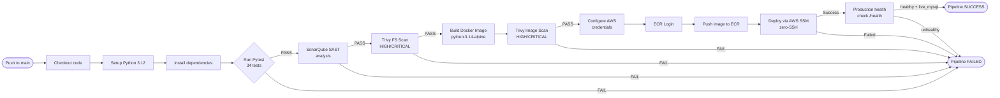

# Cloud-Based DevSecOps Platform

[](https://github.com/mohdshahid7033/cloud-devsecops-platform/actions/workflows/ci.yml)


> A production-deployed, cloud-native DevSecOps platform demonstrating end-to-end automated CI/CD pipelines with integrated security scanning, containerised deployment, and real-time observability — built as a Final Year BCA Project.

---

## Table of Contents

1. [Project Overview](#1-project-overview)
2. [Architecture](#2-architecture)
3. [CI/CD Pipeline](#3-cicd-pipeline)
4. [Technology Stack](#4-technology-stack)
5. [Repository Structure](#5-repository-structure)
6. [Local Development Setup](#6-local-development-setup)
7. [Testing](#7-testing)
8. [Security](#8-security)
9. [Infrastructure (Terraform)](#9-infrastructure-terraform)
10. [Monitoring](#10-monitoring)
11. [Production Deployment](#11-production-deployment)
12. [Project Outcomes & Key Learnings](#12-project-outcomes--key-learnings)

---

## 1. Project Overview

The **Cloud-Based DevSecOps Platform** is a full-stack web application and management console that demonstrates a complete, production-grade DevSecOps workflow. It integrates development, security, and operations tooling into a single, automated pipeline — from code commit to production deployment.

The platform serves a dual purpose:
- **A live Flask web application** acting as a consulting portal (ABC Free Consultants), complete with a MySQL-backed contact system, a Prometheus metrics endpoint, and a full REST API.
- **A DevSecOps management console** that provides a real-time dashboard showing the state of the CI/CD pipeline, security scans, infrastructure, and monitoring stack — sourced from live GitHub Actions and AWS APIs.

**Key DevSecOps Principles Demonstrated:**
- Security as a blocking gate, not an afterthought
- Infrastructure-as-Code (Terraform) for reproducible cloud environments
- Automated vulnerability scanning at both filesystem and container image layers
- Zero-SSH production deployment via AWS Systems Manager
- Containerised services with Docker Compose for local parity
- Real-time observability with Prometheus metrics and Grafana dashboards

### Project Context
This project was developed as a **Final Year BCA project**. The production environment is deployed on AWS (ap-south-1 / Mumbai region).

---

## 2. Architecture

The following diagram shows the complete system architecture across three layers: the CI/CD pipeline, the AWS production infrastructure, and the local development stack.

```mermaid
flowchart LR

    DEV["👨💻 Developer Workstation"]

    subgraph LOCAL["Local Development"]
        direction TB

        subgraph DC["Docker Compose"]
            direction TB

            L_NGINX["Nginx<br/>Reverse Proxy :80"]
            L_APP["Flask Application<br/>Container :5000"]
            L_MYSQL["MySQL<br/>Database :3306"]
            L_PROM["Prometheus<br/>Metrics :9090"]
            L_GRAFANA["Grafana<br/>Dashboards :3000"]

            L_NGINX --> L_APP
            L_APP --> L_MYSQL
            L_PROM -->|Scrapes /metrics| L_APP
            L_PROM --> L_GRAFANA
        end
    end

    DEV -->|docker compose up| DC
    DEV -->|git push / Pull Request| GH["GitHub Repository<br/>main branch"]

    subgraph CI["GitHub Actions — CI/CD Pipeline"]
        direction TB

        CHECKOUT["Checkout Source"]
        PYTHON["Python 3.12"]
        TEST["Pytest<br/>34 Tests"]
        SONAR["SonarQube<br/>Code Quality"]
        TRIVY_FS["Trivy Filesystem Scan<br/>HIGH / CRITICAL Gate"]
        BUILD["Docker Build<br/>Python 3.14 Alpine"]
        TRIVY_IMG["Trivy Image Scan<br/>HIGH / CRITICAL Gate"]
        ECR_LOGIN["AWS Authentication<br/>ECR Login"]
        PUSH["Push Image to<br/>Amazon ECR"]
        SSM["AWS SSM Deployment<br/>Zero SSH"]
        HEALTH["Production Health Check"]

        CHECKOUT --> PYTHON
        PYTHON --> TEST
        TEST --> SONAR
        SONAR --> TRIVY_FS
        TRIVY_FS --> BUILD
        BUILD --> TRIVY_IMG
        TRIVY_IMG --> ECR_LOGIN
        ECR_LOGIN --> PUSH
        PUSH --> SSM
        SSM --> HEALTH
    end

    GH --> CHECKOUT

    subgraph AWS["AWS Production — ap-south-1"]
        direction TB

        ECR["Amazon ECR<br/>devsecops-platform"]

        subgraph EC2["Amazon EC2"]
            direction TB

            NGINX["Nginx<br/>Reverse Proxy :80"]
            APP["Flask Application<br/>Container :5000"]
            MYSQL["MySQL<br/>Database :3306"]
            PROM["Prometheus<br/>Metrics :9090"]
            GRAFANA["Grafana<br/>Dashboards :3000"]

            NGINX --> APP
            APP --> MYSQL
            PROM -->|Scrapes /metrics| APP
            PROM --> GRAFANA
        end

        SSM_STORE["AWS SSM Parameter Store<br/>Production Secrets"]
    end

    PUSH --> ECR
    EC2 -->|Pull image| ECR
    SSM --> EC2

    SSM_STORE -.->|Secure credentials| APP

    USER["🌐 User / Browser"]

    USER -->|HTTP :80| NGINX
```



### Component Summary

| Component | Role | Technology | Port |
|---|---|---|---|
| Flask App | Core API & DevSecOps console | Python 3.14 / Flask 3.1.3 | 5000 |
| MySQL | Data persistence | MySQL 8.0 | 3306 |
| Nginx | Reverse proxy / ingress | nginx:alpine | 80 |
| Prometheus | Metrics collection | prom/prometheus | 9090 |
| Grafana | Observability dashboard | grafana/grafana | 3000 |
| SonarQube | SAST scanning (CI only) | sonarqube:community | 9000 |

---

## 3. CI/CD Pipeline

The pipeline is defined in [`.github/workflows/ci.yml`](.github/workflows/ci.yml) and is triggered on every push or pull request to the `main` branch. It consists of a single job with **13 sequential steps**. All security gates are **blocking** — a scan failure causes `exit 1` and halts the entire pipeline.



### Step Details

| Step | Tool / Action | Gate Type |
|---|---|---|
| Checkout code | `actions/checkout@v4` | — |
| Setup Python | `actions/setup-python@v5` (3.12) | — |
| Install dependencies | pip + requirements.txt | — |
| Run tests | `python -m pytest` | **Blocking** — fail = pipeline stops |
| SonarQube analysis | SonarScanner CLI 7.0.2 + ephemeral admin token | **Blocking** |
| Trivy filesystem scan | `trivy fs --severity HIGH,CRITICAL --exit-code 1` | **Blocking** |
| Build Docker image | `docker build` from `docker/Dockerfile` | — |
| Scan Docker image | `trivy image --severity HIGH,CRITICAL --exit-code 1` | **Blocking** |
| Configure AWS credentials | `aws-actions/configure-aws-credentials@v4` | — |
| Login to ECR | `aws-actions/amazon-ecr-login@v2` | — |
| Push to ECR | `docker push` | — |
| Deploy via SSM | `aws ssm send-command` → `AWS-RunShellScript` | **Blocking** |
| Health check | `curl http://<host>/health` — validates `status=healthy`, `mode=live_mysql` | **Blocking** |

> **Note on Python versions:** The CI runner uses **Python 3.12** (set by `setup-python`) to run tests and SonarQube analysis. The built Docker image uses **`python:3.14-alpine`** as its base, which is the version running in production.

---

## 4. Technology Stack

### Application

| Technology | Version | Purpose |
|---|---|---|
| Python | 3.12 (CI) / 3.14 (Docker) | Runtime |
| Flask | 3.1.3 | Web framework & REST API |
| PyMySQL | 1.1.1 | MySQL database driver |
| prometheus-flask-exporter | 0.23.2 | Metrics endpoint `/metrics` |
| cryptography | ≥ 42.0.0 | Secure dependency |

### Infrastructure

| Technology | Version | Purpose |
|---|---|---|
| Terraform | ≥ 1.6.0 | Infrastructure as Code |
| AWS Provider | ~> 6.0 | AWS resource management |
| Docker | Latest | Containerisation |
| Docker Compose | v2 | Local orchestration |
| Nginx | alpine | Reverse proxy |
| MySQL | 8.0 | Database |

### Security Tooling

| Tool | Integration | Purpose |
|---|---|---|
| Aqua Trivy | GitHub Actions (CI) | Filesystem & Docker image CVE scanning |
| SonarQube Community | GitHub Actions (CI) | Static application security testing (SAST) |
| AWS SSM Parameter Store | Production runtime | Secrets management (DB credentials) |
| `.trivyignore` | Trivy configuration | Documented CVE exception policy |

### Monitoring

| Tool | Purpose |
|---|---|
| Prometheus | Scrapes Flask `/metrics` for HTTP request telemetry |
| Grafana | Visualises Prometheus data via auto-provisioned dashboard |
| `/health` endpoint | Structured JSON health check used by CI pipeline as a deployment gate |

---

## 5. Repository Structure

```
cloud-devsecops-platform/
│
├── .github/
│   └── workflows/
│       └── ci.yml              # GitHub Actions CI/CD pipeline (13 steps)
│
├── app/
│   ├── app.py                  # Flask application entry point
│   ├── database.py             # MySQL connection, ORM helpers, health queries
│   ├── platform_routes.py      # REST API routes for the DevSecOps console
│   ├── platform_service.py     # Service layer: GitHub API, Trivy, SonarQube, AWS telemetry
│   ├── requirements.txt        # Python dependencies
│   ├── static/                 # CSS, JS, images
│   └── templates/
│       ├── index.html          # DevSecOps management console UI
│       └── client_app.html     # ABC Free Consultants demo application UI
│
├── docker/
│   └── Dockerfile              # Multi-stage Alpine build (python:3.14-alpine)
│
├── monitoring/
│   ├── prometheus/
│   │   └── prometheus.yml      # Prometheus scrape config (Flask target)
│   └── grafana/
│       ├── provisioning/       # Auto-provisioned datasource & dashboard configs
│       └── dashboards/         # Grafana dashboard JSON
│
├── nginx/
│   └── nginx.conf              # Reverse proxy config (port 80 → Flask 5000)
│
├── terraform/
│   ├── main.tf                 # AWS VPC, Subnet, IGW, Security Group, EC2
│   ├── variables.tf            # Input variables (region, AMI, instance type)
│   └── outputs.tf              # Output values (instance IP, etc.)
│
├── tests/
│   ├── test_app.py             # 9 tests — Flask routes, API, health endpoint
│   └── test_platform.py        # 25 tests — DevSecOps console API, security, monitoring
│
├── docker-compose.yml          # Local dev stack (5 services)
├── sonar-project.properties    # SonarQube project configuration
├── pytest.ini                  # Pytest configuration (testpaths = tests/)
└── .trivyignore                # Documented CVE exception list
```

---

## 6. Local Development Setup

### Prerequisites

- [Docker Desktop](https://www.docker.com/products/docker-desktop/) (with Docker Compose v2)
- Python 3.12+ (for running tests locally)
- Git

### 1. Clone the repository

```bash
git clone https://github.com/mohdshahid7033/cloud-devsecops-platform.git
cd cloud-devsecops-platform
```

### 2. Configure environment variables

The Docker Compose stack uses environment variables for database credentials. Create a `.env` file in the project root:

```bash
# .env (do NOT commit this file)
DB_PASSWORD=your_local_db_password
MYSQL_ROOT_PASSWORD=your_local_root_password
```

> **Note:** The `docker-compose.yml` file uses `${DB_PASSWORD:-local_db_pass_example}` with safe fallback defaults. If no `.env` file is provided, the fallback values are used for local development only. **Never use default credentials in any non-local environment.**

### 3. Start the full stack

```bash
docker compose up --build
```

This starts five services: `mysql`, `app`, `prometheus`, `grafana`, and `nginx`.

### 4. Verify the stack

| Service | URL |
|---|---|
| Application (via Nginx) | http://localhost |
| Flask app (direct) | http://localhost:5000 |
| Health endpoint | http://localhost/health |
| Prometheus | http://localhost:9090 |
| Grafana | http://localhost:3000 |

A healthy response from `/health` looks like:

```json
{
  "status": "healthy",
  "service": "devsecops-platform",
  "database": {
    "connected": true,
    "mode": "live_mysql"
  }
}
```

### 5. Install Python dependencies (for local testing)

```bash
python -m pip install -r app/requirements.txt
python -m pip install pytest
```

---

## 7. Testing

The test suite uses **[Pytest](https://docs.pytest.org/)** and is split across two files.

### Running Tests

```bash
# Run all 34 tests
python -m pytest

# Run with verbose output
python -m pytest -v

# Run a specific file
python -m pytest tests/test_app.py
python -m pytest tests/test_platform.py
```

### Test Configuration

Pytest is configured in [`pytest.ini`](pytest.ini):

```ini
[pytest]
pythonpath = .
testpaths = tests
```

### Test Summary

| File | Tests | Coverage |
|---|---|---|
| `tests/test_app.py` | 9 | Core Flask routes (`/`, `/health`, `/metrics`, `/api/status`, `/api/contact`) |
| `tests/test_platform.py` | 25 | DevSecOps console API (pipeline, security, monitoring, infrastructure, diagnostics) |
| **Total** | **34** | — |

**Locally verified result:** `34 passed` (Python 3.14.7, pytest 9.1.1)

**In CI:** `34 passed` (Python 3.12, Ubuntu-latest GitHub Actions runner)

> `test_platform.py` uses a `pytest.fixture(autouse=True)` to mock all external API calls (GitHub, Prometheus, SonarQube) during test runs, ensuring tests are deterministic and do not depend on live external services.

### Notable Test Cases

| Test | What It Verifies |
|---|---|
| `test_health` | `/health` returns `status: healthy` and `service: devsecops-platform` |
| `test_metrics` | `/metrics` exposes `flask_http_request_total` Prometheus counter |
| `test_platform_pipeline_honest_trigger` | Pipeline trigger without a GitHub token returns an honest `400` error |
| `test_platform_security_policy_wording` | `.trivyignore` CVEs are reported with accurate policy and rationale |
| `test_platform_infrastructure_environment_separation` | API cleanly separates AWS Production from local Docker state |
| `test_platform_diagnostics_context_awareness` | Each diagnostic engine includes `environment` and `check_source` — no fabricated states |

---

## 8. Security

### Security Gate Policy

All security checks in the CI pipeline are **blocking gates** with `--exit-code 1`. A scan failure aborts the pipeline immediately — there is no `|| true` or other suppression applied to security steps.

### Trivy Vulnerability Scanning

Trivy performs two independent scans on every CI run:

1. **Filesystem scan** — scans `app/requirements.txt` and project files for known CVEs in Python dependencies.
2. **Docker image scan** — scans the built `devsecops-platform:latest` container image for OS-level and package CVEs.

Both scans target `--severity HIGH,CRITICAL` with `--exit-code 1`.

#### `.trivyignore` — CVE Exception Policy

Two CVEs are explicitly ignored via [`.trivyignore`](.trivyignore):

| CVE ID | Reason for Acceptance |
|---|---|
| `GHSA-6v7p-g79w-8964` | Accepted by project policy after review. Not directly exploitable in the project's usage context. |
| `CVE-2025-47273` | Accepted by project policy after review. No fix available at the time of release; flagged for future re-evaluation. |

> These exceptions are declared explicitly and transparently in `.trivyignore`. They are not silently suppressed.

### SonarQube SAST Analysis

SonarQube Community Edition runs as a Docker **service container** inside the GitHub Actions runner. The CI step:

1. Waits for the SonarQube server to be healthy before proceeding.
2. **Rotates the default admin password** to an ephemeral, randomly generated password (`EphemeralAdminPass_${RANDOM}_$(openssl rand -hex 8)`) using `::add-mask::` to prevent log exposure.
3. Generates a short-lived analysis token (`::add-mask::` applied).
4. Runs `sonar-scanner` version 7.0.2 against the `app/` source directory.

This ensures no default or reused credentials exist within any CI run.

### AWS SSM Zero-SSH Deployment

Production deployments use **AWS Systems Manager (SSM) Run Command** with the `AWS-RunShellScript` document. This means:

- **No SSH keys are required** on the EC2 instance and no SSH port (22) is opened in the Security Group.
- The deployment script is sent as an encrypted payload through the SSM agent, which runs natively on the EC2 instance.
- The EC2 Security Group only permits **port 80 (HTTP) inbound** and all outbound.
- The CI workflow polls `get-command-invocation` until the SSM command reaches a terminal state (`Success`, `Failed`, `TimedOut`). A non-`Success` status causes the pipeline to fail.

### Secrets Management

All production database credentials are stored in **AWS SSM Parameter Store**, not in the repository or environment files:

| Parameter | Type |
|---|---|
| `/devsecops/db_name` | String |
| `/devsecops/db_user` | String |
| `/devsecops/db_password` | SecureString (encrypted) |
| `/devsecops/db_root_password` | SecureString (encrypted) |

The deployment script retrieves these at runtime using `aws ssm get-parameter --with-decryption` directly on the EC2 instance, so credentials are never logged or transmitted through the CI runner environment.

---

## 9. Infrastructure (Terraform)

AWS infrastructure is provisioned declaratively using **Terraform** (≥ 1.6.0) with the AWS provider (~> 6.0). The configuration is located in [`terraform/`](terraform/).

### Resources Provisioned

| Resource | Name | Details |
|---|---|---|
| VPC | `devsecops-vpc` | CIDR: `10.0.0.0/16`, DNS support enabled |
| Subnet | `devsecops-subnet` | CIDR: `10.0.1.0/24`, public IP on launch |
| Internet Gateway | `devsecops-igw` | Attached to VPC |
| Route Table | `devsecops-route-table` | Default route `0.0.0.0/0` → IGW |
| Security Group | `devsecops-security-group` | Inbound: TCP 80 only; Outbound: all |
| EC2 Instance | `devsecops-ec2` | t3.micro, Amazon Linux, ap-south-1 |

### Key Design Decisions

- **Port 80 only inbound:** No SSH (22) is exposed. All management is performed via SSM.
- **Public subnet with controlled SG:** The EC2 instance receives a public IP but ingress is restricted to HTTP only.

### Applying the Infrastructure

```bash
cd terraform
terraform init
terraform plan
terraform apply
```

> **Warning:** Running `terraform apply` will provision real AWS resources which incur costs. The infrastructure for this project is already deployed in the production environment.

---

## 10. Monitoring

The monitoring stack is composed of Prometheus and Grafana, automatically provisioned on both the local Docker Compose stack and the production EC2 instance.

### Prometheus

- **Configuration:** [`monitoring/prometheus/prometheus.yml`](monitoring/prometheus/prometheus.yml)
- Scrapes the Flask application's `/metrics` endpoint every 15 seconds.
- Collects `flask_http_request_total` labelled by HTTP status code, enabling request rate and status distribution analysis.

### Grafana

- **Datasource provisioning:** auto-configured to connect to Prometheus via the `devsecops-network` Docker network.
- **Dashboard provisioning:** the DevSecOps Application Monitoring dashboard is automatically provisioned on startup from [`monitoring/grafana/dashboards/`](monitoring/grafana/dashboards/).
- The dashboard is also embedded into the production deployment via the CI pipeline (the Grafana dashboard JSON is base64-encoded and injected into the SSM deployment script via `sed` to avoid shell escaping issues).

### Application Health Endpoint

`GET /health` returns a structured JSON payload used as a deployment gate by the CI pipeline:

```json
{
  "status": "healthy",
  "service": "devsecops-platform",
  "version": "1.0.1",
  "database": {
    "connected": true,
    "mode": "live_mysql",
    "latency_ms": 1.23
  }
}
```

The CI pipeline asserts that the response contains `status: healthy`, `connected: true`, and `mode: live_mysql` before declaring the deployment successful.

---

## 11. Production Deployment

### Deployment Mechanism

Production deployments are executed automatically by the CI/CD pipeline on every successful push to `main`. The deployment follows this sequence on the EC2 instance:

1. **ECR Login** — authenticate Docker to the ECR registry using `aws ecr get-login-password`.
2. **Pull latest image** — pull the image just pushed by the CI runner.
3. **Fetch secrets** — retrieve DB credentials from SSM Parameter Store at runtime.
4. **Start / restart MySQL** — idempotent check; only restarts if the container is not already running.
5. **Wait for MySQL** — polls `mysqladmin ping` up to 30 times before proceeding.
6. **Start Flask app** — inject DB credentials and environment config at container start.
7. **Configure Nginx** — write config and restart reverse proxy.
8. **Configure Prometheus** — restart with latest scrape config.
9. **Configure Grafana** — provision datasource, dashboard provider, and inject dashboard JSON.
10. **Health checks** — verify all containers are running and `curl localhost/health` returns a healthy response with a live database connection.

### Container Image

The production Docker image is built from [`docker/Dockerfile`](docker/Dockerfile):

- **Base:** `python:3.14-alpine`
- **Hardening:** `pip`, `setuptools`, and `wheel` are removed after installation to reduce attack surface.
- **Security packages:** `msgpack ≥ 1.2.1` and `setuptools ≥ 78.1.1` are pinned to patched versions.
- **Port:** 5000 (exposed; proxied via Nginx on port 80).

### Production Release

| Item | Value |
|---|---|
| Git Tag | `v1.0.1-final` |
| Commit | `fb305208d3be4ebe331890fb8daadd556e75171a` |
| AWS Region | `ap-south-1` (Mumbai) |
| ECR Repository | `devsecops-platform` |
| Deployment method | AWS SSM `AWS-RunShellScript` |

---

## 12. Project Outcomes & Key Learnings

This project demonstrates the following DevSecOps concepts through practical, production-deployed implementation:

### What Was Built and Deployed

| Outcome | Detail |
|---|---|
| **Automated CI/CD pipeline** | 13-step GitHub Actions workflow from code to production |
| **Security-as-code** | Trivy and SonarQube integrated as non-optional, blocking pipeline gates |
| **Infrastructure-as-Code** | Complete AWS environment defined and reproducible via Terraform |
| **Zero-SSH cloud deployment** | AWS SSM eliminates the need for SSH keys or exposed ports |
| **Secrets management** | All production credentials stored and retrieved from AWS SSM Parameter Store |
| **Containerised application** | Docker multi-stage Alpine build; five-service Compose stack |
| **Real-time observability** | Live Prometheus scraping + auto-provisioned Grafana dashboard |
| **Honest telemetry** | Platform dashboard reflects real GitHub Actions and AWS API state |

### Key Learnings

- **DevSecOps is a cultural and architectural decision:** Integrating Trivy and SonarQube as pipeline gates early forces security considerations into every code change.
- **Infrastructure parity matters:** Using Docker Compose locally with the same service definitions as production significantly reduces "works on my machine" failures.
- **Secrets management complexity in CI/CD:** Passing secrets to SSM commands without logging them required careful use of `sed` for script injection, runtime Parameter Store retrieval, and `::add-mask::` in Actions.
- **Disk space and idempotency in production:** Long-running SSM deployments require idempotent container management (`docker stop || true`, `docker rm || true`) and monitoring of EC2 disk usage.
- **Honest observability:** A monitoring dashboard that fabricates data is worse than no dashboard. The platform service layer is designed to honestly report `UNAVAILABLE` states rather than show false-positive health.

---

*This project was developed as a Final Year BCA project. The production environment is deployed on AWS and may not remain active after the project submission period.*
